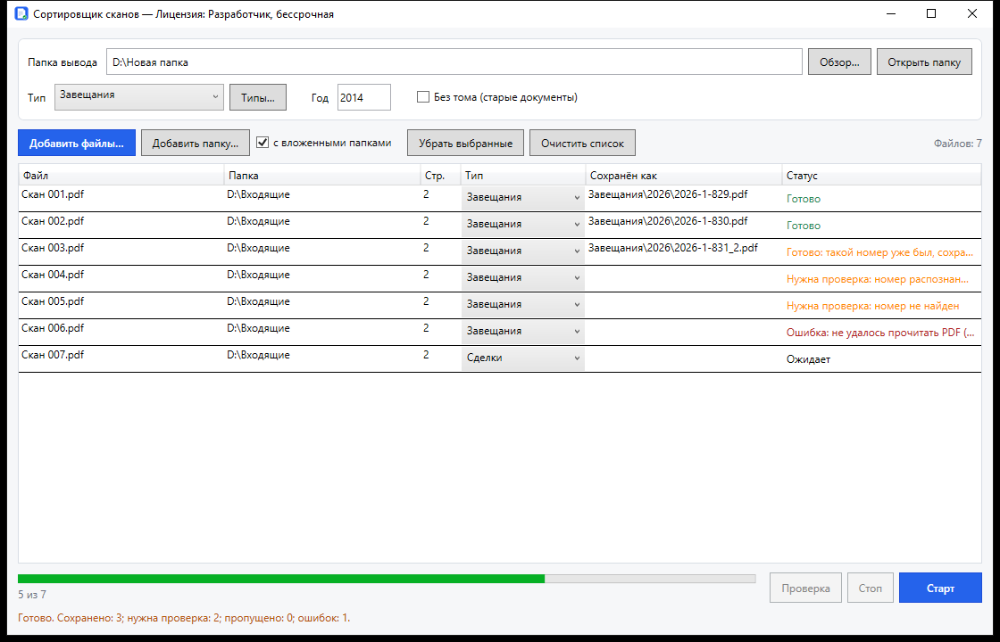

# Сортировщик сканов

**ScanSorter** помогает привести архив готовых PDF-сканов к единому порядку: находит реестровый номер в документе, присваивает понятное имя и складывает копию в нужную папку.

Добавьте файлы, выберите тип документов и папку вывода, нажмите **«Старт»**. Программа обработает список, а сомнительные номера предложит проверить по изображению документа.



*Актуальное окно программы. Имена файлов и результаты на снимке приведены для примера.*

## Что умеет программа

- Загружать PDF-файлы и целые папки, включая вложенные; поддерживает перетаскивание в окно.
- Обрабатывать многостраничные документы и партии файлов.
- Распознавать реестровый номер двумя независимыми средствами и сопоставлять результаты.
- Сохранять копии с именами вида `2026-1-829.pdf`, а для старых документов без тома — `2001-23.pdf`.
- Работать с буквенными обозначениями, например `2001-В-37.pdf`.
- Показывать спорные записи в одном окне проверки со счётчиком и переходами между файлами.
- Создавать папки по типу документа и году, а также отчёт об обработке.

## Как работает сортировка

```text
Готовые PDF → Распознавание номера → Сопоставление результатов
                                      ├─ Уверенный результат → Сохранение копии
                                      └─ Нужна проверка → Подтверждение пользователем → Сохранение копии
```

Программа ищет номер в удостоверительной надписи, обычно рядом со словами «Зарегистрировано в реестре». Для многостраничного PDF поиск начинается с конца документа; проверяются последние четыре страницы.

Согласованные результаты двух средств распознавания позволяют сохранить файл автоматически. При расхождении, плохом качестве скана или отсутствии номера запись отправляется на проверку. Это снижает риск неправильного имени, но не гарантирует безошибочного распознавания, особенно рукописных цифр.

Каждый добавленный PDF считается одним документом и сохраняется целиком. Содержимое файла копируется без изменений: страницы, качество изображения, текстовый слой и исходный формат сохраняются. После копирования программа сверяет целостность копии.

**Распознавание выполняется на компьютере. Документы не отправляются в облачные сервисы.**

## Начало работы

Для запуска нужна **Windows x64** и выданная для вашего компьютера лицензия. Скачайте `ScanSorter.exe` из [последнего релиза](https://github.com/tokatim/ScanSorter/releases/latest). Отдельно устанавливать .NET, Python или Java не требуется.

1. Запустите `ScanSorter.exe` и при первом запуске активируйте лицензию по инструкции ниже.
2. Нажмите **«Обзор…»** и выберите папку, куда сохранять результат.
3. Выберите **«Тип»**, например «Завещания» или «Сделки». Через **«Типы…»** можно добавить свои варианты. Тип отдельных файлов можно изменить в таблице перед запуском.
4. При работе со старыми документами заполните поле **«Год»**. Если тома в номере нет, включите **«Без тома (старые документы)»**.
5. Нажмите **«Добавить файлы…»**, **«Добавить папку…»** или перетащите PDF в окно. Для загрузки подпапок включите **«с вложенными папками»**.
6. Нажмите **«Старт»**. Ход обработки и результат каждого файла появятся в списке. Во время работы список можно прокручивать; кнопка **«Стоп»** останавливает обработку с учётом уже выполняющихся файлов.
7. Проверьте спорные номера и сохраните подтверждённые записи.
8. По завершении выберите, оставить исходные файлы или переместить успешно обработанные исходники в корзину Windows.

## Имена файлов и папки

Результат сохраняется по схеме **«Папка вывода → Тип → Год → Файл»**.

| Номер в документе | Настройки | Итоговое имя |
|---|---|---|
| `…-2026-1-829` | Обычный режим | `2026-1-829.pdf` |
| `№ 1-154`, год в номере отсутствует | В поле «Год»: `2017` | `2017-1-154.pdf` |
| `N 23`, том отсутствует | «Без тома», год `2001` | `2001-23.pdf` |
| `N В-37` | Год `2001`; при необходимости исправление в проверке | `2001-В-37.pdf` |

Пример готовой папки:

```text
Сканы/
└─ Завещания/
   ├─ 2001/
   │  ├─ 2001-23.pdf
   │  └─ 2001-В-37.pdf
   └─ 2026/
      ├─ 2026-1-829.pdf
      └─ 2026-1-829_2.pdf
```

Если имя уже занято, добавляется суффикс `_2`, `_3` и далее. Существующие файлы не перезаписываются. Для старых документов поле **«Год»** общее для партии: документы разных лет удобнее обрабатывать отдельными запусками.

## Проверка спорных номеров

Записи со статусом **«Нужна проверка»** можно открыть кнопкой **«Проверка (N)»**. В окне видны страницы документа, варианты распознавания и поля для исправления номера.

- **Счётчик `1 / 30`** показывает текущую запись и общее количество записей в проверке.
- **«Предыдущий» / «Следующий»** переключают документы. Сочетания клавиш: **Ctrl + ← / Ctrl + →**.
- Стрелки над изображением переключают страницы самого PDF; ползунок меняет масштаб.
- В поле **«Номер»** можно указать цифры, а при необходимости букву и дефис: `37` или `В-37`.
- **«Сохранить и далее»** или **Enter** сохраняет подтверждённый файл и открывает следующую запись.
- Запись можно пропустить и вернуться к ней позже в текущем сеансе. Окно проверки можно закрыть и снова открыть кнопкой **«Проверка (N)»**.

Перед сохранением сверяйте номер с документом. Рукописные обозначения, нечёткие сканы и повреждённые файлы могут потребовать ручного ввода.

## Что означают статусы

| Статус | Что делать |
|---|---|
| **Ожидает** | Файл добавлен и ждёт обработки. |
| **Готово** | Копия сохранена в папке вывода. |
| **Готово: такой номер уже был…** | Копия сохранена с суффиксом; проверьте, действительно ли это другой документ. |
| **Нужна проверка** | Откройте проверку и подтвердите либо исправьте номер. |
| **Ошибка** | Посмотрите причину в статусе; при необходимости проверьте, открывается ли исходный PDF. |

Двойной щелчок по строке открывает результат, а если он ещё не создан — исходный PDF. Через правую кнопку мыши можно открыть исходный файл, результат или показать файл в папке.

## Как получить лицензию

Лицензия выдаётся владельцем программы и привязана к конкретному компьютеру. Для каждого рабочего места требуется свой ключ.

1. Скачайте `ScanSorter.exe` из раздела [Releases](https://github.com/tokatim/ScanSorter/releases/latest) и запустите его на том компьютере, где будете работать.
2. В окне **«Активация программы»** нажмите **«Копировать»** рядом с кодом компьютера.
3. Отправьте код владельцу программы тем способом, которым вы получили приложение. Укажите, для кого нужна лицензия. Автор проекта на GitHub: [tokatim](https://github.com/tokatim).
4. Получив ключ, вставьте его в поле **«Вставьте полученный ключ»** или нажмите **«Вставить из буфера»**.
5. Нажмите **«Активировать»**. При следующих запусках ключ повторно вводить не нужно.

Срок действия определяется выданной лицензией: она может быть бессрочной или действовать до указанной даты. После активации интернет для работы программы не нужен. Для продления лицензии или переноса на другой компьютер обратитесь к владельцу программы; повторная активация также может понадобиться после существенного изменения компьютера.

## Исходники и результат

Исходные PDF остаются на месте до вашего решения об удалении. В конце программа предлагает переместить в корзину только те исходники, для которых успешно сохранён результат. Неподтверждённые и ошибочные записи не должны удаляться вместе с обработанными.

В папке вывода создаётся **«Отчёт сортировки …csv»** со списком исходных файлов, результатами и замечаниями. Кнопка **«Открыть папку»** открывает папку результата.

Программа сохраняет формат исходного PDF, включая PDF/A, если он уже был в исходнике. Если отметка PDF/A-1b не обнаружена, появляется предупреждение; преобразование в PDF/A не выполняется.